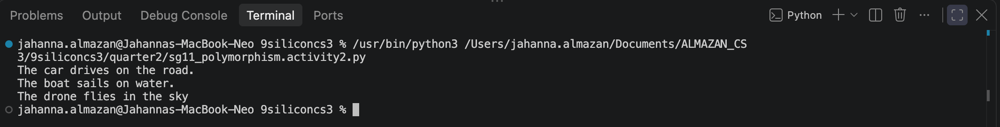

## 1. Answer the following question:
  ### a. What is duck typing, as explained in the video?
  Duck typing means Python doesn't care what type an object is or what class it comes from. If an object has the method you want to call, you can call it.

  ### b. What did the Car class need to have so it could work inside the same loop as Dog and Cat, even if it does not inherit from the Animal class?
  It just needed to have the same method name. It does not need to inherit from a common parent class. As long as the method exists, Python can call it.

## 2. Python Code:
[View Python Code: Activity 2](quarter2/sg11_polymorphism.activity2.py)
  OUTPUT:
  

## 3. How does the code in 2.2 demonstrate polymorphism?
  We used one function name, which is start_trip(), but it behaved differently depending on which object we passed in. Each class has its own version of the move() method, yet they all work with the same function without needing a shared parent class. This is polymorphism through duck typing.